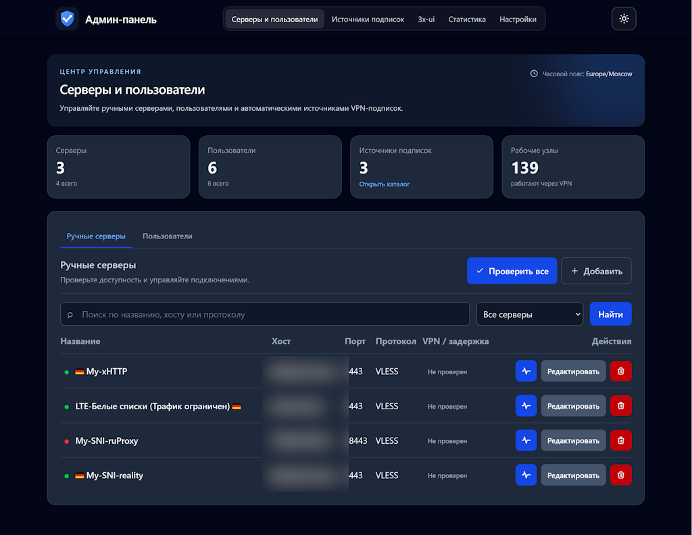
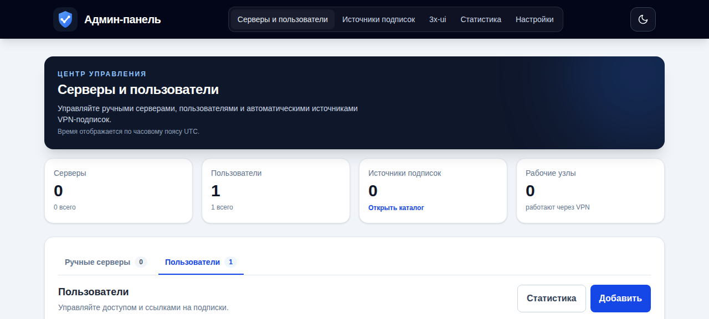
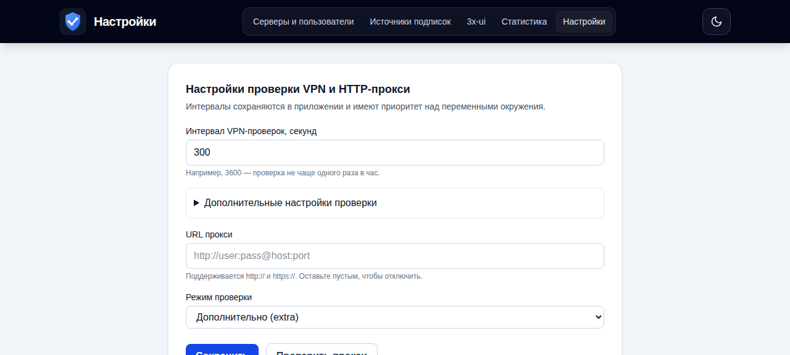
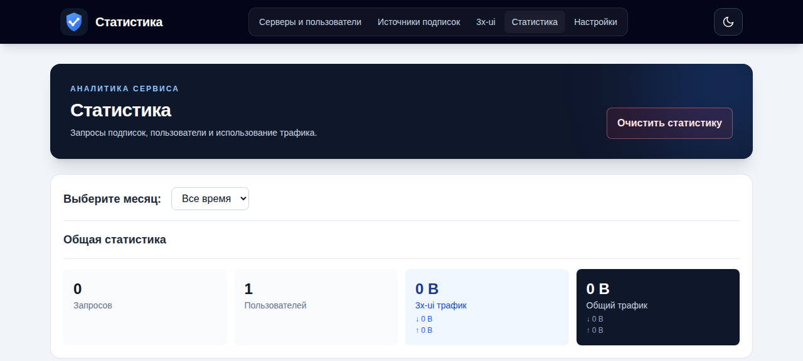
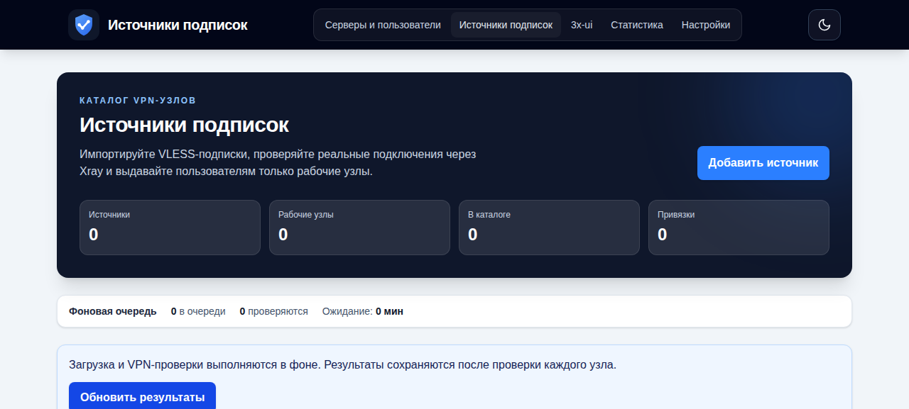

# VPN Subscription Service

Сервис формирования VPN-подписок с админ-панелью: ручные назначения серверов и автоматический отбор работающих VLESS-узлов из внешних источников.

Xray используется как временный клиент для проверок внешних VPN. Пользовательский трафик идёт напрямую на выданные узлы; VPN-сервер для пользователей здесь не поднимается.

## Скриншоты

### Ручные серверы



### Пользователи



### Настройки



### Статистика



### Источники подписок



## Возможности

- **Админ-панель** для управления серверами и пользователями
- **Поддержка протоколов**: VLESS, VMess, Trojan, Shadowsocks
- **Импорт серверов** из ссылок (vless://, vmess://, trojan://, ss://)
- **Генерация подписок** в формате Base64 (совместимо с 3X-UI, Happ и др.)
- **Маршрутизация через Caddy** с пробросом `/join/*`
- **Внешние источники**: HTTP(S), plain/Base64/Base64URL VLESS, периодическое обновление и сохранение каталога
- **Реальные VPN-проверки**: VLESS TCP/WS/XHTTP/gRPC с TLS или без TLS, TCP/XHTTP/gRPC Reality (включая Vision), HTTPS 204, задержка и причины ошибок
- **Автоматическая выдача**: лимит узлов на источник, порог задержки, приоритет, дедупликация и контроль свежести
- **Фоновые задачи**: ограниченная очередь, прогресс в админ-панели, восстановление расписания

Настройка, матрица совместимости и эксплуатация: [внешние подписки и Xray](docs/EXTERNAL_SUBSCRIPTIONS.md).

После обновления поддержки протоколов перезапустите приложение. Сохранённые ссылки будут автоматически повторно разобраны, а ранее неподдерживаемые Reality/`security=none` узлы поставлены на VPN-проверку. Назначения источников и настройки исключения узлов сохраняются.

## Требования

- Node.js 22+
- npm
- Для VPN-проверок: Xray-core **26.10.21**. Поддерживаются Linux и локальное тестирование на Windows.

## Установка

```bash
npm ci
npm run build:css
```

CSS интерфейса собирается локально из `src/styles.css` в `public/app.css`; внешние CDN для Tailwind не используются.

**Важно:** База данных `data/subscription.db` будет автоматически создана при первом запуске.

## Конфигурация

Скопируйте `.env.example` в `.env` и настройте параметры:

```bash
cp .env.example .env
```

Параметры в `.env`:

| Параметр | Описание | По умолчанию |
|----------|----------|--------------|
| `PORT` | Порт сервера | `4000` в `.env.example`, `2096` без настройки |
| `APP_NAME` | Название приложения (в интерфейсе) | `VPN Подписки` |
| `SESSION_SECRET` | Секрет для сессий | Задать в `.env` |
| `PUBLIC_DOMAIN` | Публичный домен для QR кодов | `your-domain.com` |
| `ADMIN_USERNAME`, `ADMIN_PASSWORD` | Временные данные первого администратора; после первого входа задаётся новый пароль | Задаются только при первом запуске |
| `XRAY_PATH` | Абсолютный путь к бинарнику Xray | Linux: `/usr/local/bin/xray`; Windows: `tools/xray/xray.exe` в проекте |
| `XRAY_VERSION` | Проверяемая версия Xray | `26.10.21` |
| `PROBE_CONCURRENCY` | Одновременные VPN-проверки | `4` |
| `PROBE_HTTP_PROXY` | HTTP(S)-прокси для дополнительной проверки узлов: Xray дозванивается до узла через этот прокси, отдельно измеряется задержка (бейдж «Прокси») | Пусто — проверка без прокси |
| `PROBE_HTTP_PROXY_MODE` | `extra` — обычная проверка + дополнительная через прокси; `only` — все проверки только через прокси | `extra` |
| `PROFILE_UPDATE_INTERVAL_HOURS` | Интервал обновления профиля для клиента | `1` |

Перед первым запуском задайте `SESSION_SECRET` и временный `ADMIN_PASSWORD`. При первом входе приложение потребует сменить его на новый пароль. После создания администратора `ADMIN_PASSWORD` можно удалить из `.env`. Статистика 3x-ui собирается через API после добавления панели в админке. Полный набор настроек с ограничениями приведён в `.env.example` и [документации](docs/EXTERNAL_SUBSCRIPTIONS.md).

### Установка Xray на Linux

```bash
sudo bash scripts/install-xray.sh
```

Скрипт проверяет SHA-256 официального архива и устанавливает только бинарник. Скопируйте выведенный `XRAY_VERSION` в `.env`. Сервис сам запускает и останавливает Xray для каждой проверки; отдельный постоянно работающий Xray-сервис не нужен.

### Установка Xray и тестирование на Windows

В PowerShell из каталога проекта:

```powershell
.\scripts\install-xray.ps1
```

Установщик скачивает Xray 26.10.21, проверяет SHA-256 и размещает `xray.exe` в `tools/xray`. Установка в каталог проекта работает с правами обычного пользователя. Скопируйте выведенные `XRAY_PATH` и `XRAY_VERSION` в `.env`. Для локальных QR-кодов задайте `PUBLIC_DOMAIN=`.

```powershell
npm run test:vpn
npm start
```

Тест автоматически берёт путь к Xray из `.env`; при пустом `XRAY_PATH` на Windows используется `tools/xray/xray.exe`. Панель доступна на `http://localhost:4000/admin` при `PORT=4000`. Приложение само запускает Xray для проверок. Останавливайте его через `Ctrl+C`.

Подробности: [Windows и PowerShell](docs/EXTERNAL_SUBSCRIPTIONS.md#windows-и-powershell).

## Запуск

```bash
npm start
```

### Docker

```bash
docker build -t vpn-subscription-service .
docker run --name vpn-subscription-service --env-file .env -p 2096:2096 -v vpn-subscription-data:/app/data vpn-subscription-service
```

Для production задайте `PORT`, соответствующий проброшенному порту, и сохраните `SESSION_SECRET`, `PUBLIC_DOMAIN` и `ADMIN_PASSWORD` в `.env` до первого входа.

Перед запуском или после изменения шаблонов пересоберите локальные стили:

```bash
npm run build:css
```

Для разработки с автоматическим перезапуском при изменениях:

```bash
npm start watch
```

Также можно использовать `npm run dev`. На Windows и macOS отслеживаются файлы в `src/` (включая EJS-шаблоны), `public/` и `.env`. На Linux встроенный watch-режим Node.js отслеживает загруженные JS-модули. База данных и логи не вызывают перезапуск. Чтобы увидеть изменения страницы, обновите её в браузере.

## Админ-панель

- URL: http://localhost:port/admin
- Логин: значение `ADMIN_USERNAME` (по умолчанию `admin`)
- Временный пароль: значение `ADMIN_PASSWORD`

При первом входе приложение принудительно откроет форму смены пароля. Новый пароль должен содержать минимум 8 символов. После успешной смены `ADMIN_PASSWORD` можно удалить из `.env`; новый пароль хранится в базе в виде хеша.

## Структура проекта

```
├── src/
│   ├── index.js          # Главный файл приложения
│   ├── db/
│   │   └── database.js    # SQLite схема и подключение
│   ├── utils/
│   │   └── linkBuilder.js # Генерация ссылок подписок
│   └── views/             # EJS шаблоны
│       ├── login.ejs
│       ├── dashboard.ejs
│       ├── server-form.ejs
│       ├── user-form.ejs
│       └── user-servers.ejs
├── data/                  # SQLite база данных (создается автоматически)
├── package.json
└── README.md
```

## Формат ссылки подписки

После создания пользователя и назначения ему серверов, ссылка подписки будет доступна по адресу:

```
http://your-domain.com/join/{user_id}
```

Или в Base64 формате (для 3X-UI / Happ):

```
http://your-domain.com/join/{user_id}
```

Приложение автоматически возвращает Base64-закодированный список серверов.

## Интеграция с Caddy

Добавьте в `Caddyfile` (замените ${PORT} на ваш PORT из `.env`):

```caddy
# подписки
@sub path /join*
handle @sub {
    reverse_proxy http://[::]:${PORT} {
        header_up Host localhost:${PORT}
        header_up X-Real-IP {remote_host}
    }
}
```

## Запуск на сервере (постоянный)

### Вариант 1: systemd на Linux

Готовый unit: [`deploy/vpn-subscriptions.service`](deploy/vpn-subscriptions.service). Инструкция создания системного пользователя, настройки прав и запуска — в [документации](docs/EXTERNAL_SUBSCRIPTIONS.md#linux-и-systemd).

### Вариант 2: Supervisor 3.1

Supervisor запускает приложение от пользователя `ubuntu` и автоматически перезапускает его после сбоя. Используйте абсолютный путь к Node.js и запускайте `src/index.js` напрямую: у Supervisor часто отличается `PATH`, поэтому `command=npm start` может завершаться с `spawn error`. Путь Node.js узнайте командой `command -v node`.

Если Supervisor установлен как плагин aaPanel, системный `supervisorctl` может быть недоступен. В этом случае используйте путь из окружения aaPanel:

```bash
sudo /www/server/panel/pyenv/bin/supervisorctl status
sudo /www/server/panel/pyenv/bin/supervisorctl reread
sudo /www/server/panel/pyenv/bin/supervisorctl update
sudo /www/server/panel/pyenv/bin/supervisorctl restart subcsriptions:subcsriptions_00
```

Имя процесса можно посмотреть командой `status`; оно формируется из имени секции `[program:...]` и `process_name`.

Для автоматического обновления проекта, установки зависимостей, сборки CSS и перезапуска приложения используйте универсальный скрипт [`deploy/deploy.sh`](deploy/deploy.sh). Настройки вынесены в файл `.deploy.env` в корне проекта, который не добавляется в Git:

```bash
cd /home/ubuntu/servers-list-subscriptions
cp .deploy.env.example .deploy.env
chmod +x deploy/deploy.sh
nano .deploy.env
./deploy/deploy.sh
```

Пример настроек для aaPanel Supervisor:

```env
PROJECT_DIR=/home/ubuntu/servers-list-subscriptions
DEPLOY_BRANCH=main
INSTALL_COMMAND="npm ci"
BUILD_COMMAND="npm run build:css"
RESTART_COMMAND="sudo /www/server/panel/pyenv/bin/supervisorctl restart subcsriptions:subcsriptions_00"
```

Для systemd замените `RESTART_COMMAND`:

```env
RESTART_COMMAND="sudo systemctl restart vpn-subscriptions.service"
```

Для Docker Compose:

```env
RESTART_COMMAND="docker compose up -d --build"
```

Скрипт использует `git pull --ff-only`, останавливается при первой ошибке и не перезапускает приложение, если `RESTART_COMMAND` пустой.

Создайте конфигурацию, например `/etc/supervisor/conf.d/subcsriptions.conf`:

```ini
[program:subcsriptions]
command=/usr/bin/node /home/ubuntu/servers-list-subscriptions/src/index.js
directory=/home/ubuntu/servers-list-subscriptions/
autorestart=true
startsecs=3
startretries=3
stdout_logfile=/www/server/panel/plugin/supervisor/log/subcsriptions.out.log
stderr_logfile=/www/server/panel/plugin/supervisor/log/subcsriptions.err.log
stdout_logfile_maxbytes=2MB
stderr_logfile_maxbytes=2MB
user=ubuntu
priority=999
numprocs=1
stopsignal=SIGTERM
stopasgroup=true
killasgroup=true
stopwaitsecs=10
process_name=%(program_name)s_%(process_num)02d
```

Перед запуском убедитесь, что каталог проекта принадлежит `ubuntu`, `.env` заполнен, зависимости установлены, а CSS собран. Если используется aaPanel Node.js, замените `/usr/bin/node` в `command` на результат `command -v node` от пользователя, под которым работает Supervisor:

```bash
cd /home/ubuntu/servers-list-subscriptions
npm ci
npm run build:css
```

Команды Supervisor:

```bash
sudo /www/server/panel/pyenv/bin/supervisorctl reread
sudo /www/server/panel/pyenv/bin/supervisorctl update
sudo /www/server/panel/pyenv/bin/supervisorctl status subcsriptions:subcsriptions_00
sudo /www/server/panel/pyenv/bin/supervisorctl start subcsriptions:subcsriptions_00
sudo /www/server/panel/pyenv/bin/supervisorctl stop subcsriptions:subcsriptions_00
sudo /www/server/panel/pyenv/bin/supervisorctl restart subcsriptions:subcsriptions_00
```

Если `status` показывает `ERROR (spawn error)`, выполните на сервере:

```bash
command -v node
ls -ld /home/ubuntu/servers-list-subscriptions
sudo -u ubuntu /usr/bin/node --version
sudo -u ubuntu /usr/bin/node /home/ubuntu/servers-list-subscriptions/src/index.js
```

Последняя команда должна либо запустить приложение, либо вывести точную ошибку Node. Для aaPanel используйте фактический путь Node.js вместо `/usr/bin/node`.

После изменения `.env`, кода или шаблонов пересоберите CSS при необходимости и выполните:

```bash
cd /home/ubuntu/servers-list-subscriptions
npm run build:css
sudo /www/server/panel/pyenv/bin/supervisorctl restart subcsriptions:subcsriptions_00
```

Просмотр логов:

```bash
tail -f /www/server/panel/plugin/supervisor/log/subcsriptions.out.log
tail -f /www/server/panel/plugin/supervisor/log/subcsriptions.err.log
```

Если `supervisorctl` не находит процесс, проверьте имя секции и список процессов:

```bash
sudo /www/server/panel/pyenv/bin/supervisorctl status
sudo /www/server/panel/pyenv/bin/supervisorctl reread
sudo /www/server/panel/pyenv/bin/supervisorctl update
```

Используйте один экземпляр приложения. `sql.js` владеет БД в памяти; cluster-режим с несколькими экземплярами не поддерживается. Второй экземпляр останавливается при обнаружении блокировки БД.

### Вариант 3: PM2

PM2 — менеджер процессов для Node.js, который автоматически перезапускает приложение при сбоях и после перезагрузки сервера.

Используйте один экземпляр приложения. `sql.js` владеет БД в памяти; cluster-режим с несколькими экземплярами не поддерживается. Второй экземпляр останавливается при обнаружении блокировки БД.

```bash
# Установите PM2 глобально
npm install -g pm2

# Запустите приложение
pm2 start src/index.js --name vpn-subscriptions

# Сохраните список процессов для автозапуска после перезагрузки
pm2 save

# Настройте автозапуск при загрузке системы
pm2 startup
```

**Полезные команды PM2:**
```bash
pm2 status              # Посмотреть статус
pm2 logs vpn-subscriptions  # Посмотреть логи
pm2 restart vpn-subscriptions  # Перезапустить
pm2 stop vpn-subscriptions    # Остановить
```


## Статистика 3x-ui через API

Webhook отключён по умолчанию. Для получения трафика пользователей и inbound-подключений:

1. В 3x-ui откройте **Settings → Security → API Token** и создайте токен.
2. В приложении откройте **Админка → 3x-ui → Добавить панель**.
3. Укажите URL панели, включая секретный base path, если он настроен, например `https://panel.example.com/secret-path`.
4. Вставьте API token и сохраните панель.

Приложение автоматически опрашивает endpoint 3x-ui `/panel/api/inbounds/list`, сохраняет статистику локально и показывает её в **Админка → Статистика**. Интервал синхронизации задаётся для каждой панели.

Токен хранится в локальной базе приложения. Не публикуйте его и не добавляйте в `.env`, shell history или сторонние логи.

## API эндпоинты

| Метод | Путь | Описание |
|-------|------|----------|
| GET | `/healthz` | Публичная проверка доступности сервиса и планировщика |
| GET | `/admin` | Админ-панель (требует авторизации) |
| GET | `/admin/login` | Страница входа |
| POST | `/admin/login` | Авторизация |
| GET | `/admin/logout` | Выход |
| GET | `/join/:id` | Получить подписку (Base64) |
| GET | `/join/:id/json` | Получить подписку (JSON) |
| GET | `/join/:id/qr`, `/join/:id/qr-img` | QR-код ссылки подписки, в том числе для пользователя только с источниками |
| GET | `/admin/subscription-sources` | Источники, каталог и сохранённые VPN-проверки |
| POST | `/api/subscription-sources/:id/sync` | Фоновая загрузка, `202 + jobId` |
| POST | `/api/subscription-sources/:id/check` | Фоновая VPN-проверка, `202 + jobId` |
| GET | `/admin/threexui` | Настройка панелей 3x-ui и запуск синхронизации |
| POST | `/api/threexui/sync` | Принудительная синхронизация всех активных панелей 3x-ui |
| POST | `/api/threexui/:id/sync` | Принудительная синхронизация одной панели 3x-ui |
| GET | `/api/background-jobs/:id` | Прогресс задачи (требует авторизации) |
| GET | `/api/users/:id/subscription-preview` | Сохранённый состав и причины недобора (требует авторизации) |

## Проверки

```bash
npm test
# Локальный VPN-стенд; Xray берётся из .env или стандартного пути для ОС
npm run test:vpn
```

`npm test` использует временные БД, локальный HTTP и тестовые реализации сетевых задач. Интеграционный VPN-тест запускает настоящий Xray с локальным тестовым сервером и HTTPS-целью; внешние подписки и Google для него не нужны.

## Лицензия

MIT
